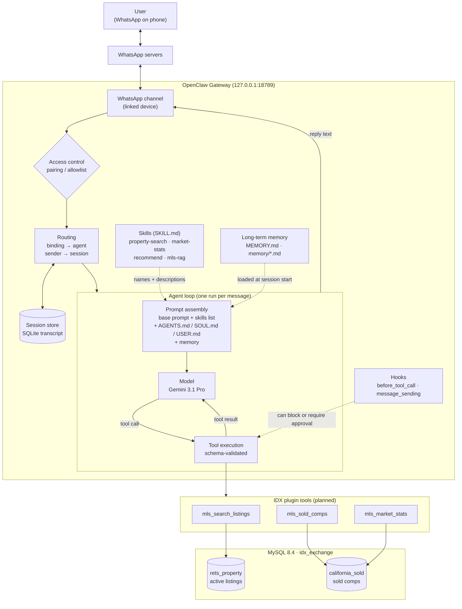
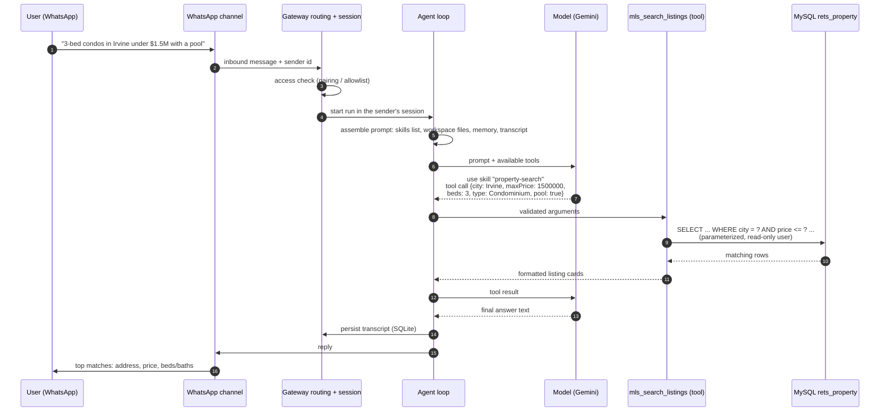

# Architecture: how a WhatsApp message reaches the MLS database

This document describes how the IDX-Exchange Agent is put together on top of
[OpenClaw](https://github.com/openclaw/openclaw), and traces a property-search
question from a user's phone to the MySQL tables and back.

Status markers used below:

- **Running**: set up and working today.
- **Planned (Week N)**: designed here, built in that week of the program.

## Components at a glance

| Component | What it is in OpenClaw | Role in this project | Status |
|---|---|---|---|
| **Gateway** | One long-lived Node process per machine. Owns every channel connection, all session state, and runs agents. Clients connect over WebSocket on `127.0.0.1:18789`. | The runtime everything else plugs into. | Running |
| **Channel** | A messaging integration inside the Gateway. WhatsApp is linked as a WhatsApp Web "linked device" (Baileys). | Users talk to the assistant over WhatsApp. Email follows in Week 11. | Running (WhatsApp) |
| **Access control** | DM policy (`pairing` / `allowlist`) decides who may reach the agent at all. Unknown senders get a pairing code an operator must approve. | Keeps strangers from driving an agent that can run tools. | Running |
| **Session** | Per-conversation state and transcript, stored in SQLite. Every run in a session is serialized, so two messages never race. | Remembers the search criteria across turns (Week 4). | Running |
| **Agent loop** | The per-message cycle: assemble context, call the model, execute tool calls, stream the reply, persist the transcript. | Turns "3-bed condo in Irvine" into tool calls and an answer. | Running |
| **Model** | The LLM behind the agent. Configured as Gemini 3.1 Pro. | Understands the question and decides which tools to call. | Running |
| **Skills** | `SKILL.md` instruction files. Their names and descriptions are injected into the system prompt; the model reads them and decides which applies. | One skill per capability: property search, market stats, recommendations, RAG. | Planned (Weeks 2–8) |
| **Tools** | Typed functions registered by a plugin (`api.registerTool`) with a TypeBox parameter schema. The model calls them; OpenClaw validates the arguments and runs them. | The only path to MySQL: parameterized, read-only queries. | Planned (Week 3) |
| **Memory** | Short-term: the session transcript (compacted when long). Long-term: Markdown files in the agent workspace (`MEMORY.md`, `memory/*.md`) plus memory search. | User preferences; later a vector index of listing remarks (Week 6). | Running (built-in) |
| **Hooks** | Plugin hooks such as `before_tool_call` and `message_sending` that can inspect, block or rewrite actions. | Safety gates: human approval before any email is sent (Week 11). | Planned (Week 11) |
| **Multi-agent routing** | Several isolated agents in one Gateway, each with its own workspace and sessions, selected by bindings or delegated to as sub-agents. | A coordinator that routes to search, market and RAG specialists (Week 9). | Planned (Week 9) |
| **MySQL `idx_exchange`** | Not part of OpenClaw: a local MySQL 8.4 server. | `rets_property` (active listings) and `california_sold` (sold comps). | Running |

## System diagram



## One question, end to end

The user asks: *"Show me 3-bedroom condos in Irvine under $1.5M with a pool."*



Step by step:

1. **Inbound.** The phone sends the message to WhatsApp's servers. The Gateway is
   linked to the same account as a WhatsApp Web device, so it receives the message.
2. **Access control.** The WhatsApp channel checks the sender against the DM
   policy. An unknown sender gets a pairing code instead of an answer.
3. **Routing.** A binding maps the WhatsApp account to an agent (`main` today).
   The sender maps to a session. By default all DMs share one session; a
   multi-client assistant needs `session.dmScope: "per-channel-peer"` so each
   client gets an isolated conversation.
4. **Run admission.** Runs are serialized per session, so a quick follow-up
   message waits for (or steers) the current run instead of racing it.
5. **Prompt assembly.** OpenClaw builds the system prompt from its base prompt,
   the list of eligible skills (name + description), the workspace bootstrap
   files (`AGENTS.md`, `SOUL.md`, `USER.md`, `IDENTITY.md`), loaded memory, and
   the session transcript.
6. **Skill selection.** There is no separate keyword router: the model reads
   the skills list and decides that the `property-search` skill applies, then
   follows its instructions.
7. **Tool call.** The skill tells the model to call `mls_search_listings` with
   structured filters. OpenClaw validates the arguments against the tool's
   TypeBox schema before running it.
8. **Database.** The tool runs a parameterized `SELECT` against `rets_property`
   as a read-only MySQL user, with a `LIMIT` for pagination.
9. **Answer.** The tool result goes back to the model, which writes the reply.
10. **Persist and deliver.** The transcript is committed to SQLite and the reply
    is sent back through the WhatsApp channel.

## Handbook concepts vs. how OpenClaw does it

The program's Week 1 notes describe the flow as
*User → WhatsApp → Runtime → Skill Selector → Tool Execution → Memory Update → Response*.
Reading OpenClaw's source and docs showed a few differences worth knowing before
building on it:

| Handbook term | What it actually is in OpenClaw |
|---|---|
| Skill Selector | Not a separate component. Skills are advertised in the system prompt and the **model** chooses. Good skill descriptions are what make routing work. |
| Tool = `async function` with an `if (message.includes(...))` dispatcher | A tool is registered by a **plugin** with `api.registerTool({ name, description, parameters, execute })`. The model decides when to call it; no keyword matching in our code. |
| Memory Update | Two layers: the session transcript (automatic, SQLite) and long-term Markdown memory in the workspace, which the agent writes when something is worth keeping. |
| Orchestrator | Multi-agent routing via **bindings** (which agent owns a channel account) and **sub-agents** an agent can delegate to. The Week 9 coordinator builds on these. |
| Sessions | Keyed by where the message came from. DMs share one session unless `dmScope` isolates them. Important for a real estate assistant with many clients. |

The handbook's minimal tool example becomes this in OpenClaw's plugin API
(sketch, built for real in Week 3):

```ts
api.registerTool({
  name: "get_current_time",
  description: "Return the current time in ISO 8601 format",
  parameters: Type.Object({}),
  async execute() {
    const currentTime = new Date().toISOString();
    return {
      content: [{ type: "text", text: currentTime }],
      details: { currentTime },
    };
  },
});
```

## Design decisions for the coming weeks

- **Database access only through tools.** The model never writes raw SQL.
  Tools take typed filters and build parameterized queries, so prompt injection
  in a WhatsApp message cannot become SQL injection.
- **Read-only database user.** The agent connects as a MySQL user with `SELECT`
  only on `idx_exchange`. Root is for imports and admin.
- **One skill per capability.** Property search, market stats, recommendations
  and RAG each get their own `SKILL.md`, which keeps descriptions specific and
  makes the model's routing predictable.
- **Isolated sessions per client.** Turn on `per-channel-peer` DM scope before
  anyone other than the developer can message the agent.
- **Human approval before side effects.** Outbound email goes through a
  `before_tool_call` / `message_sending` gate that requires explicit approval.
- **Secrets stay out of git.** API keys and database passwords live in `.env`
  (ignored); `.env.example` documents the variables.
- **Data stays out of git.** The MLS dumps are licensed CRMLS data and are never
  committed.

## Planned skills and tools

| Week | Skill | Tools | Tables |
|---|---|---|---|
| 2 | `property-search` (parse free text into filters) | none yet: returns a filter object | none |
| 3 | `property-search` | `mls_search_listings`, `mls_sold_comps` | `rets_property`, `california_sold` |
| 4 | `property-search` (multi-turn) | same, plus session state | `rets_property` |
| 5 | `market-stats` | `mls_market_stats` | `california_sold` |
| 6 | `semantic-search` | `mls_semantic_search` | `rets_property` remarks embeddings |
| 7 | `recommend` | `mls_recommend` | both |
| 8 | `mls-rag` | memory / document search | field definitions |
| 9 | coordinator agent | sub-agent delegation | both |
| 10 | WhatsApp polish | channel features | both |
| 11 | `email-drafts` | `email_draft`, `email_send` (approval-gated) | both |

## References

- OpenClaw docs in the repo: `docs/concepts/architecture.md`,
  `docs/concepts/agent-loop.md`, `docs/concepts/session.md`,
  `docs/concepts/multi-agent.md`, `docs/tools/skills.md`,
  `docs/plugins/building-plugins.md`, `docs/channels/whatsapp.md`
